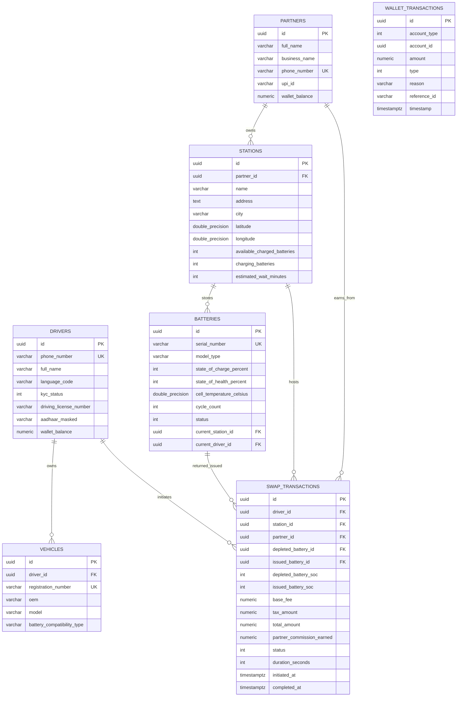
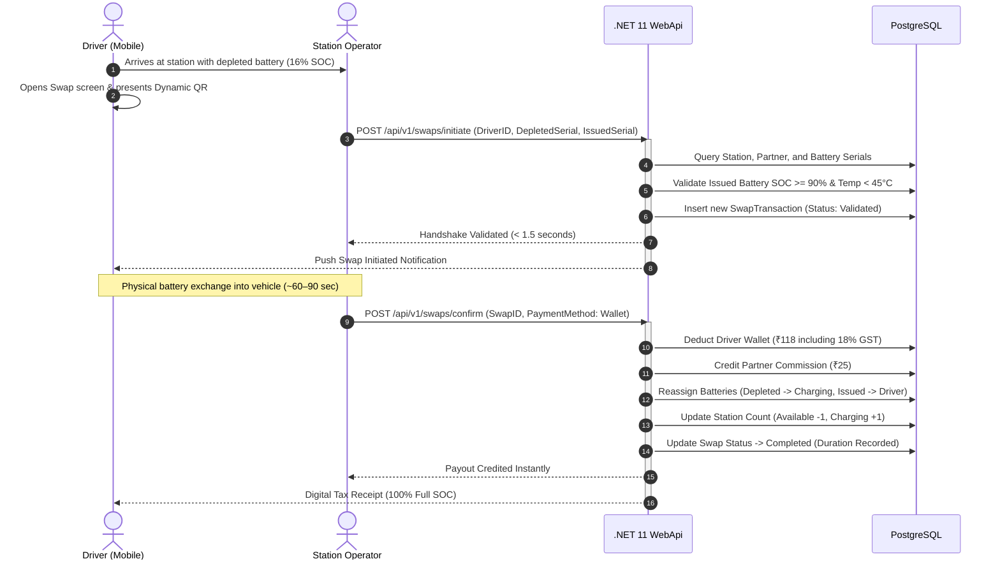

# ChargeLoop — Technical Architecture Blueprint

**Platform:** .NET 11 (Core Backend) | PostgreSQL (Database) | Flutter (Cross-Platform Mobile)  
**Target Environments:** Android (Primary), Apple iOS & macOS (Expansion Ready)  

---

## 1. System Topology Overview

```mermaid
flowchart TD
    subgraph Clients["Client Layer"]
        DA["Driver Mobile App (Flutter: Android / iOS)"]
        PA["Partner Mobile App (Flutter: Android / macOS)"]
        WebAdmin["Admin & Operations Console (Web)"]
    end

    subgraph API["Backend Service Layer (ASP.NET Core .NET 11)"]
        Gateway["Reverse Proxy & Rate Limiter (Kestrel / YARP)"]
        Hub["SignalR Hub (/hubs/stations) - Live Real-Time Push"]
        
        subgraph Controllers["WebApi REST Controllers"]
            AuthCtrl["AuthController (OTP, KYC, Vehicle Link)"]
            StationCtrl["StationsController (Nearby, Availability)"]
            SwapCtrl["SwapsController (Initiate, Confirm, History)"]
            WalletCtrl["WalletController (Balance, UPI Top-Up)"]
            TelemCtrl["TelemetryController (SOC, Temp, GPS)"]
        end

        subgraph CoreServices["Domain & Application Services"]
            StationSvc["StationService (Haversine Spatial Search)"]
            SwapSvc["SwapService (Validation & 2-Min Engine)"]
            WalletSvc["WalletService (Double-entry Ledger)"]
            DriverSvc["DriverService (Identity & Verification)"]
        end
    end

    subgraph DataTier["Data & Cache Tier"]
        PG[("PostgreSQL Database (Localhost / RDS)\nTables: drivers, vehicles, stations, batteries, swaps, wallets")]
        Redis[("Redis 7 (In-Memory Cache & Distributed Lock)")]
    end

    DA -->|HTTPS REST| Gateway
    PA -->|HTTPS REST| Gateway
    WebAdmin -->|HTTPS REST| Gateway
    
    DA -.->|WebSocket SignalR| Hub
    PA -.->|WebSocket SignalR| Hub

    Gateway --> Controllers
    Controllers --> CoreServices
    CoreServices -->|Entity Framework Core (Npgsql)| PG
    CoreServices -.->|Cache & Lock| Redis
```

---

## 2. Backend Clean Architecture (.NET 11)

The backend is organized into four decoupled layers following Clean Architecture and Domain-Driven Design (DDD):

```
backend/
├── ChargeLoop.slnx
├── ChargeLoop.Domain/            # Enterprise Business Rules & Entities
│   ├── Entities/                 # Driver, Vehicle, Station, Partner, Battery, SwapTransaction, WalletTransaction
│   └── Enums/                    # KycStatus, StationStatus, BatteryStatus, SwapStatus, PaymentMethod
├── ChargeLoop.Application/       # Application Business Rules
│   ├── DTOs/                     # Strongly-typed records (StationDto, SwapResponse, WalletTopUpRequest)
│   └── Interfaces/               # Service contracts (IStationService, ISwapService, IWalletService, IDriverService)
├── ChargeLoop.Infrastructure/    # External Concerns & Data Access
│   ├── Persistence/              # ChargeLoopDbContext (EF Core Npgsql), Schema DDL
│   ├── Services/                 # Concrete service implementations querying PostgreSQL
│   └── DependencyInjection.cs    # Service registration and DbContext lifecycle setup
└── ChargeLoop.WebApi/            # Interface Adapters & HTTP Pipeline
    ├── Controllers/              # RESTful API controllers
    ├── Hubs/                     # StationHub (SignalR bi-directional push)
    ├── wwwroot/                  # Web app static assets
    └── Program.cs                # Kestrel configuration, CORS, and middleware pipeline
```

### Key Architectural Traits
1. **Zero Hardcoded Data**: All queries in `StationService`, `DriverService`, `SwapService`, and `WalletService` execute against PostgreSQL via `ChargeLoopDbContext`.
2. **Sub-1.5s Swap Latency**: Highly optimized asynchronous queries (`AsNoTracking()`, selective projection) ensure rapid validation during physical battery swaps.
3. **Double-Entry Financial Safety**: Wallet operations are atomic. Every driver debit has an immutable audit log, and partner commission credits (₹25) are written in the same transaction boundary.

---

## 3. Database Schema Design (PostgreSQL)

The database runs on PostgreSQL at `localhost:5432/chargeloop`.



---

## 4. The 2-Minute Physical Swap Sequence



---

## 5. Mobile Application Client Architecture (Flutter)

* **Multiplatform Portability**: Single Dart codebase compiling directly to native ARM machine code on Android, iOS, and macOS desktop without bridging penalties.
* **Sunlight-Optimized Theme**:
  * Dark slate backgrounds (`#0F141A`, `#1A222C`) with high-contrast electric accents (Neon Green `#00E676`, Cyan `#00E5FF`, Safety Amber `#FFB300`).
  * Minimum **52dp** touch targets tailored for gig riders operating on motorbikes with gloves.
* **Network & Offline Caching**:
  * Uses `http` with timeout interceptors.
  * Local caching ensures that drivers can view saved station bookmarks and history even if 3G connectivity drops while driving through low-network pockets.
* **State Management**: Reactive StateFlow / Provider pattern separating presentation widgets from business logic and REST/SignalR services.

---

## 6. Real-Time Communication with SignalR

Instead of having thousands of mobile devices constantly polling the server every few seconds (which drains battery and overloads APIs), ASP.NET Core SignalR provides event-driven pushes:

* **Hub Route**: `/hubs/stations`
* **Events**:
  * `ReceiveStationUpdate(StationDto)`: Dispatched to all drivers whenever battery stock changes at any station.
  * `StationInventoryChanged(StationDto)`: Scoped to drivers currently navigating to a specific station group (`Station_{id}`).
  * `ReceiveSwapStatus(SwapResponse)`: Dispatched directly to the driver's private session (`Driver_{id}`) when their swap completes.
