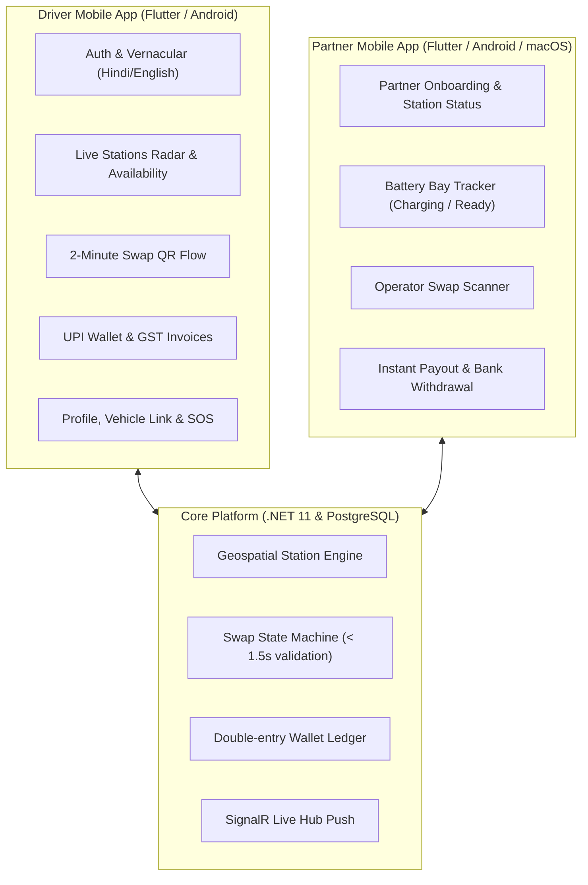

# ChargeLoop Mobile Application Suite — Product Requirements Document (PRD)

**Version:** 1.0  
**Status:** Approved for Implementation  
**Date:** November 2026  
**Primary Platform Focus:** Android first (low-spec & gig-worker optimized), scalable to iOS & macOS  

---

## 1. Executive Summary & Vision

ChargeLoop operates India's largest Battery-as-a-Service (BaaS) swapping network for electric 2-wheelers and 3-wheelers (e-rickshaws, delivery bikes, commercial gig fleets). Instead of spending hours tethered to a slow charger, drivers exchange a depleted battery for a fully charged, IoT-monitored battery pack in **under 2 minutes** at local partner stations.

### The Product Suite
1. **ChargeLoop Driver App**: The gig-worker cockpit for real-time station discovery, battery range radar, 2-minute QR swap initiation, UPI wallet recharge, and driver welfare benefits.
2. **ChargeLoop Partner App**: The station operator tool (for local kirana shops and auto garages) to log swaps, monitor charging bay inventory, and receive instant per-swap commission credits.
3. **ChargeLoop Rider App**: For rental e-scooter riders to unlock, rent, and swap on demand.
4. **Admin & Operations Platform**: Centralized web console for station fleet management, dynamic city pricing, fraud prevention, and IoT battery health monitoring.

---

## 2. Problem Statement & Market Opportunity

| User Segment | Core Pain Point | ChargeLoop Solution |
| :--- | :--- | :--- |
| **EV Drivers (2W / 3W)** | Earning time lost searching for stations or arriving at empty stations with no charged batteries. Complex subscription pricing. | Real-time map radar showing exact charged battery count, wait time, 1-tap navigation, and transparent 2-minute swap execution. |
| **Station Partners (Kirana / Garages)** | Manual reconciliation, delayed weekly/monthly commission payouts, and fear of battery theft/faults. | Instant digital wallet credit per swap (₹25), automated battery serial handshake, and clear live inventory tracking. |
| **Operations & Risk Teams** | Lack of visibility into battery thermal health, cell degradation, and geofence theft. | Real-time IoT telemetry ingestion tracking State of Charge (SOC), State of Health (SOH), and temperature alerts. |

---

## 3. User Personas

* **Ravi (35, Tier-2 City E-Rickshaw Driver)**:
  * *Profile*: Uses an affordable Android smartphone (Android 8+, 2GB RAM), variable 3G/4G connectivity, speaks Hindi.
  * *Needs*: Needs the nearest station with ready batteries, clear daily swap costs, and large high-contrast touch buttons.
* **Sana (27, Metro Delivery Gig Rider)**:
  * *Profile*: High-intensity driver working for quick-commerce apps, highly tech-literate.
  * *Needs*: Fast turnaround under 2 minutes between orders, low battery push alerts (< 20% SOC), and instant UPI top-ups.
* **Imran (45, Kirana Shop Station Partner)**:
  * *Profile*: Operates a corner grocery store hosting 12 battery charging bays.
  * *Needs*: Zero paperwork, rapid barcode scan of returned and issued batteries, and instant wallet credit for every completed swap.
* **Priya (32, City Operations Manager)**:
  * *Profile*: Manages 60 stations across Delhi NCR.
  * *Needs*: Live dashboard showing bay utilization, stock-outs, queue times, and battery overheating alerts.

---

## 4. Product Scope & Core Modules (Phase 1 & Phase 2)

---

## 5. Key User Journeys

### 5.1 The 2-Minute Physical Swap Journey
1. **Arrival**: Driver arrives at station (e.g. *Janakpuri Swap Hub*) with low battery (SOC $\le$ 20%).
2. **Scan & Handshake**: Driver scans station QR code via Driver App or presents dynamic token.
3. **Validation (< 1.5s)**: Backend verifies driver identity, active subscription/wallet balance, and confirms issued battery has $\ge$ 90% SOC with healthy cell temperature (< 45°C).
4. **Physical Exchange**: Station operator swaps the depleted battery into a charging bay and installs the charged battery into the driver's EV (~60–90 seconds).
5. **Settlement**: Operator taps "Complete Swap". Driver's wallet is deducted (₹118 including 18% GST), partner wallet is instantly credited (₹25), and digital tax receipt is issued.

### 5.2 Wallet Top-Up Journey
1. Driver taps "Wallet" in bottom navigation.
2. Driver taps quick recharge chip (`+ ₹100`, `+ ₹250`, or `+ ₹500`).
3. App invokes UPI AutoPay / UPI Intent (Google Pay, PhonePe, Paytm).
4. Instant webhook updates PostgreSQL ledger and updates live balance on screen.

---

## 6. MoSCoW Feature Prioritization

* **Must Have (M)**:
  * Phone OTP login with English & Hindi support.
  * Real-time station map & list with live battery counts and wait times.
  * 2-minute swap execution flow with battery serial validation.
  * Digital wallet ledger with instant partner credit.
  * Vehicle linking (`2W_48V` / `3W_60V` compatibility checks).
  * PostgreSQL persistent storage with zero-variance accounting.
* **Should Have (S)**:
  * Native camera QR barcode scanning.
  * Turn-by-turn navigation via Google Maps intent.
  * Vernacular voice prompts for low-literacy drivers.
  * Driver Welfare Fund insurance portal and 24/7 SOS alert.
  * Partner app battery inventory bay grid.
* **Could Have (C)**:
  * Station battery pre-reservation (15-minute hold en route).
  * Referral program and swap milestone gamification.
  * Predictive battery maintenance alerts.
* **Won't Have (W - This Release)**:
  * 4-wheeler EV swapping.
  * Physical station charger firmware build (handled by hardware IoT team).

---

## 7. Success Metrics & Business KPIs

* **Median Swap Time**: $\le$ 2 minutes from station arrival to roll-out.
* **Swap Success Rate**: $\ge$ 99.0% without validation or payment stalls.
* **API Response Time**: $\le$ 50ms for station queries, $\le$ 1.5s for swap handshake.
* **Accounting Reconciliation**: 0.00% variance in driver debits vs partner credits.
* **Crash-Free Sessions**: $\ge$ 99.5% on budget Android 8+ devices.
